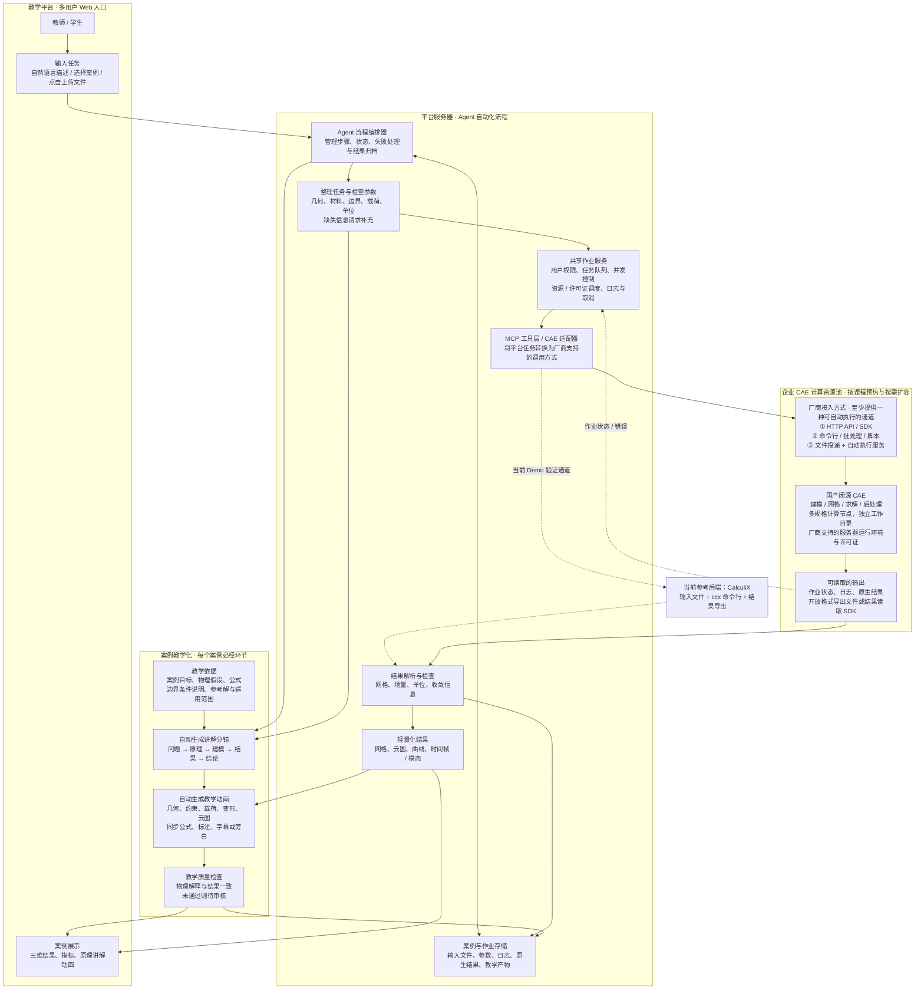

# AI+ CAE 的案例教学化加工和平台部署方案

## 1. 整体框架

本方案以 CAE 能力接入为核心。当前采用 CalculiX 验证求解和结果展示流程，最终采用企业方的国产闭源 CAE，并将软件部署在服务器上，供教师和学生通过 Web 平台共享使用。

**Agent 指整条自动化流程**：接收任务或文件，准备模型和参数，调用服务器上的 CAE，监控作业，读取结果，并为每个案例自动生成原理讲解动画。自然语言是入口之一，点击选择案例、上传文件和填写参数也可以启动同一流程。

### 1.1 目标架构图

以下为目标设计，不代表当前 Demo 已完成所有模块。



### 1.2 国产闭源 CAE 的接入与交付边界

不要求企业方开放源码，也不要求企业方自行实现 MCP。平台负责封装适配器，将统一任务规格转换为厂商支持的接口或文件。平台作业服务生成 `run_id`，并关联厂商作业编号或执行进程。

| 企业方提供什么 | 平台用来做什么 | 可接受的交付方式 |
| --- | --- | --- |
| 模型、材料、边界与工况的输入方式 | 自动准备和修改案例 | 参数化工程模板、输入文件规范、建模 API 或脚本 |
| 可自动执行的求解入口 | Agent 提交服务器作业 | HTTP API、SDK、命令行、批处理，或文件投递配套执行服务 |
| 作业状态与日志 | 排队、监控、错误定位、判断是否完成 | 状态接口、日志文件、完成标识；明确错误码和退出规则 |
| 可读取的结果 | 转成网页轻量化数据并生成动画 | 开放格式导出，或原生文件加读取 SDK；包含拓扑、字段、单位和帧信息 |
| 服务器运行与授权条件 | 支撑多人共享使用与弹性扩容 | 安装包、环境说明、无界面运行能力、许可证并发及计费规则、多节点 / 虚拟机 / 云部署支持范围 |
| 算力需求与并行能力 | 选择节点规格并估算课堂容量 | 典型模型的 CPU、内存、临时磁盘需求；GPU 及跨节点并行是否支持；启动耗时、故障恢复与检查点能力 |
| 经确认的教学案例资料 | 支撑动画讲清楚原理 | 案例说明、物理假设、公式来源、参考结果、适用范围 |

三种自动接入方式可以择一实施：

- **API / SDK 接入**：适配器调用厂商提供的建模、求解、状态和结果接口。
- **命令行 / 脚本接入**：适配器生成参数或输入文件，启动批处理任务，读取退出状态、日志和结果。
- **文件接入**：平台投递任务清单和工程文件，服务器执行服务自动拾取任务并启动 CAE，再写回状态和结果。必须约定任务标识、文件完整性、完成标志和错误格式。

**只有工程文件或结果截图，无法实现完整自动求解流程。**文件接入也需要配套自动执行和结果导出能力；如果企业方只能提供预计算结果，可以先实现案例展示与教学动画。若只有桌面 GUI，需要另行评估图形界面自动化的稳定性和服务器运行条件。

### 1.3 服务器共享使用方式

用户通过浏览器提交任务，无需在个人电脑安装 CAE。平台服务器负责身份、任务编排、队列和数据访问；CAE 服务器负责运行企业软件。两者可以在试点阶段部署于同一台机器，职责仍保持分离。

每次作业使用独立目录和标识，任务调度同时考虑 CPU、内存和许可证可用数量。用户可以查看自己的进度、日志和结果；教学案例可以按课程共享。CAE 原生结果保存在服务端，浏览器加载经过转换的轻量数据。

当前 CalculiX 是这套接入契约的参考实现。后续需要根据国产 CAE 的输入、单元类型、字段和运行方式开发适配器，不能假设直接替换可执行文件即可完成迁移。

### 1.4 每个案例自动生成原理讲解动画（实现方案待调研）

**每个案例都必须自动生成一份教学动画，讲清楚问题、原理、建模依据和结果含义。**云图播放只是动画的一部分。动画至少应回答：研究什么问题、使用什么物理假设、为什么这样施加边界与载荷、结果为什么呈现这种分布，以及结论适用于什么范围。

目标流程为：案例资料与求解结果 → 讲解分镜 → 三维场景及公式标注 → 动画渲染 → 教学质量检查 → 案例归档。求解完成与教学产物完成应分别记录状态；动画生成失败时保留求解结果，允许单独重试动画环节。

待调研内容包括教学知识来源、分镜自动生成、公式与三维结果同步、字幕和旁白、浏览器动画与视频导出，以及解释正确性的检查方法。早期应采用经审核的案例模板，并由教师审核自动生成内容。

静力案例的变形动画应标明是变形比例演示；动态案例按求解时间帧播放；模态案例应说明振型归一化与显示缩放，避免混淆物理含义。

### 1.5 课堂多人并发与弹性扩容方案

**企业 CAE 服务必须按“多人同时访问、部分用户同时求解”的课堂场景设计。**在线人数、同时求解数和同时查看三维结果的人数应分别估算。现有 Demo 只验证了基本求解链路，尚未实现或验证下述弹性扩容与课堂容量保障能力。

#### 1.5.1 分离交互服务与重计算资源

| 负载 | 资源安排 | 扩容与性能保障方式 |
| --- | --- | --- |
| 登录、案例浏览、任务提交与进度查询 | Web/API 与流程编排服务 | 独立于求解节点部署；状态持久化后可增加服务实例，避免求解占满资源导致页面无响应 |
| 建模、网格与 CAE 求解 | 按 CPU、内存及厂商支持情况划分的计算资源池 | 作业进入队列，由调度器匹配节点规格；资源不足时申请新增节点，达到上限后继续排队 |
| 结果解析、轻量化与教学动画生成 | 独立后台任务队列与资源配额 | 与求解分别控制并发，避免集中出结果时争抢内存、磁盘或 GPU |
| 三维结果与动画访问 | 结果存储及缓存服务 | 共用已发布的教学产物，按需加载网格和时间帧，降低重复下载与后端处理压力 |

计算资源池增加节点，主要用于同时运行更多独立作业。**单个大模型能否加速，仍取决于求解器的并行能力。**不能默认企业软件支持 GPU、容器或跨节点分布式求解；不支持容器时，可使用厂商认可的虚拟机或物理机执行节点。单机内存不足的作业需要匹配更大内存节点，不能靠增加多台小机器自动解决。

#### 1.5.2 课前预热与运行时扩缩容

1. **按课程预约容量**：教师提前登记班级人数、案例、预计同时求解数和上课时间。课前准备节点、检查许可证、加载案例模板，并执行小作业验证环境，避免全班提交后才开始安装软件或启动机器。
2. **按队列和资源需求扩容**：综合等待作业数、最久等待时间、待运行任务的 CPU / 内存需求和可用许可证决定扩容。节点完成软件、存储和授权检查后才能接收作业，不能仅凭 CPU 使用率判断容量是否足够。
3. **设置扩容边界**：为课程或租户配置节点上限、并发上限、预算和允许使用的资源池。资源来自现有机房、私有云还是获准使用的公有云，应在部署时确认；本地没有闲置资源且未接通外部资源池时，只能排队或提前增配硬件。
4. **安全缩容**：课后或低负载时，节点先停止接收新任务，待求解、导出及结果归档完成后再回收，并设置空闲等待时间，避免频繁启停。运行中的作业不因缩容被强制终止；仅在求解器支持且已验证检查点恢复时安排中断迁移。

许可证是独立的容量约束。调度器需按厂商实际的席位、核心数或 token 规则预留授权额度；无可用授权时展示等待原因，避免反复启动失败。扩容节点不代表许可证会同步增加，需提前确认授权服务器容量、网络可达性以及多节点和云部署许可范围。

#### 1.5.3 课堂调度与卡顿控制

- **异步提交与进度反馈**：提交后立即返回作业编号，由后台执行，页面显示排队、启动、求解、结果处理和完成等状态。排队时说明是等待算力还是许可证；预计等待时间基于实测统计给出，不能承诺所有学生同时立即开算。
- **公平使用与课堂保障**：限制每位学生的运行数和待运行任务数，按课程配额公平调度；为教师演示预留小部分容量，优先处理尚未启动的演示任务，同时避免学生作业长期得不到执行。
- **作业资源隔离**：按案例设置 CPU、内存、临时磁盘和运行时间限额；超大模型在提交时提示或转入课后批处理队列。取消、超时或节点故障后应核实求解进程和授权释放状态；重试前核对原作业状态，避免重复求解或重复占用许可证。
- **教学模板与预计算复用**：标准案例提前求解并生成讲解动画，课堂浏览直接读取已发布产物；学生修改参数后再提交新作业。复用结果时校验模型、参数、求解器版本和模板版本，并遵守课程访问权限，不能把旧结果当作新工况结果。
- **浏览器与数据传输优化**：控制默认网格精度和帧数，使用压缩、分块、缓存及按需加载；按教学终端性能提供简化显示。浏览器渲染、校园网络带宽和共享存储吞吐需要单独验证，增加求解节点不能消除这些瓶颈。

#### 1.5.4 容量估算与上线验收

先选取轻量、中等和较重的代表案例，实测每个作业的核心数、峰值内存、临时磁盘、求解时长、结果大小及授权消耗，再根据课程并发需求确定节点规格与数量。容量规划应为操作系统、结果处理和测量误差预留余量。

例如，假设一个班有 60 名学生，其中 20 人集中提交求解；实测某案例每个作业需要 4 核 CPU、峰值内存 8 GB，且每个作业占用 1 个并发授权。若要求这 20 个作业同时运行，则仅求解部分就需要至少 80 核、160 GB 内存及 20 个可用并发授权，另加系统与处理余量；若仅有 5 个授权，则最多同时运行 5 个此类作业，其余排队。此示例仅说明估算方法，不代表企业 CAE 的实测配置或授权规则。

上线前按真实课堂节奏压测“集中登录 → 打开案例 → 集中提交 → 集中查看结果”，并覆盖多班同时上课、冷启动、许可证耗尽、节点故障与课后缩容。验收至少记录：

| 指标 | 验收关注点 |
| --- | --- |
| Web/API 响应时间与错误率 | 高求解负载时仍能浏览、提交、查询和取消；记录 P95 响应时间 |
| 排队等待与求解完成时间 | 分别记录等待时间、执行时间及端到端时间，确认能否满足课堂时长 |
| 扩容就绪时间 | 从触发扩容到节点可接作业的实际耗时，用于确定课前预热提前量 |
| 资源与授权利用情况 | CPU、峰值内存、磁盘容量 / 吞吐、网络和许可证是否成为瓶颈 |
| 结果展示体验 | 典型学生设备上的首屏时间、交互帧率及多人同时加载时的带宽占用 |
| 故障与成本控制 | 作业不丢失、不重复执行；缩容不误杀任务；课程资源与预算上限有效 |

具体并发人数、响应时间和等待时间目标应在试点前由学校与企业共同确定，再以压测结果验收。资源不足时，课堂可先使用明确标识的预计算案例开展讲解，新参数作业继续排队，不能用回放结果冒充实时求解结果。

## 2. 整体 Demo 的展示和实现

### 2.1 当前页面的主要模块

当前 Demo 已经从原有 Fluent 对话入口切换为 CAE 工作台，左侧使用树形案例筛选：

- **CalculiX**
  - 悬臂梁·静力：真实生成、求解并导出结果。
  - 悬臂梁·模态：真实提取固有频率和振型。
- **Abaqus**
  - 带孔板·静力：通过 Abaqus/CAE 脚本重新求解并导出结果，页面标为 `RUN`，实际运行仍需检查 Abaqus 环境。
  - 其他案例：当前主要作为已有结果回放。
- **近场动力学**
  - 预裂纹拉伸：展示 Peridigm 结果回放。

左侧带 `RUN` 标记的案例允许提交真实求解；没有 `RUN` 标记的案例用于教学回放和结果查看。

### 2.2 演示链路

以“CalculiX 悬臂梁·静力”为例：

1. 用户点击案例树选择案例，页面加载对应的已有结果文件；可以在输入框描述任务并在参数区域填写数值。
2. 点击生成 CaseSpec 并确认参数。当前尚未实现从自然语言自动提取完整参数，不能将该按钮视为已经接入 Agent。
3. 点击“确认并启动 CalculiX”。前端向 Web 后端提交任务参数。
4. 后端调用 `MCP/CalculiX/web_run.py`，生成标准 CalculiX 输入文件。
5. 后端启动 `ccx`，读取 `.dat` 等结果，并检查求解是否正常结束。
6. 结果导出器生成 `result_mesh.json`，包含节点、单元、位移、应力范围和来源信息。
7. Viewer 加载轻量网格，显示变形、云图、摘要指标和本次作业状态。
8. 当前结果查看器具备帧播放基础；逐案例自动生成原理讲解动画是下一阶段目标，尚未实现。

以“Abaqus 带孔板·静力”为例，前端会调用现有 Abaqus/CAE noGUI 脚本，生成 ODB，再由导出脚本转换为 Viewer 数据。该案例是否能真实运行取决于服务器上是否安装 Abaqus 并正确设置 `ABAQUS_COMMAND`。

### 2.3 当前 Demo 已实现的模块

| 模块 | 当前状态 |
| --- | --- |
| 案例树形筛选 | 已实现，可按软件、案例和标签筛选 |
| NLP 输入框 | 已实现页面输入和 CaseSpec 展示；尚未连接外部大模型 |
| CalculiX 真实求解 | 已实现本地服务器调用、静力和模态示例 |
| Abaqus 带孔板静力 | 已接入已有脚本，需 Abaqus 运行环境 |
| MCP 工具链 | 已有 CalculiX MCP 与结果导出工具 |
| 轻量结果网格 | 已实现 `result_mesh.json` |
| 三维结果 Viewer | 已支持静力、模态、动态结果的基本展示 |
| 结果摘要 | 已显示最大应力、最大位移、频率和网格规模 |
| 作业日志 | 已在页面显示本次提交过程和错误 |
| 教学动画 | 已具备结果帧播放基础；完整教学步骤动画尚未全部接通 |

当前网页运行接口通过后端脚本调用求解工具；仓库已有 MCP 工具不等于网页已经完成 MCP 协议调用。目标 Agent 需要补齐统一编排与 MCP 客户端。任意用户文件上传及校验也属于待完善入口，应与点击案例加载已有文件区分。

### 2.4 部署方式

开发演示时可以在 Viewer 工程目录启动 Vite 服务，并让 Node 后端调用本机的 CalculiX Python 环境。正式服务器部署时建议按职责拆分服务，并将重计算任务放入可扩展的资源池：

```text
浏览器 → Web/API → Agent → 共享作业服务 → MCP/适配器 → 国产 CAE 计算资源池
                              ↓                          ↓
                       案例与作业存储 ← 结果检查与轻量化
                              ↓
                    自动生成原理讲解动画 → Web 展示
```

Web/API 服务负责用户、案例和权限；Agent 负责流程编排；共享作业服务负责队列、日志和进程；MCP/适配器封装厂商能力；CAE 节点负责软件运行。动画生成作为独立任务执行。计算资源池由调度器按资源和授权分配作业，并结合课表预热及队列需求扩缩容，详见 1.5 节。上述为目标部署方式，多用户共享与弹性扩容能力尚需建设。

## 3. 当前情况下哪些可以做，哪些问题无法避免

### 3.1 当前基础与可推进工作

当前已有按钮选择案例、加载已有结果、CalculiX 示例求解、轻量化导出和网页显示基础。下一步可在有限案例范围内，将这些步骤组织成可追踪、可重试的 Agent 自动化流程。

| 工作 | 当前基础与实施条件 |
| --- | --- |
| 点击案例并查看结果 | 已有案例树和 Viewer |
| 提交参数并调用 CalculiX | 已有示例脚本与 Web 运行入口 |
| Agent 自动完成端到端流程 | 需要补齐编排、状态、参数校验和 MCP 调用 |
| 接入国产闭源 CAE | 取决于企业方提供可执行入口与可读结果，需开发适配器 |
| 服务器供多人共享与弹性扩容 | 需要队列、用户隔离、资源与许可证调度、课前预热、计算节点扩缩容和课堂并发压测 |
| 每个案例自动生成原理动画 | 必需目标；知识、分镜、渲染与质量检查方案待调研 |

### 3.2 当前 Demo 不能直接承诺的能力

- **自然语言尚未等于完整 AI Agent**：当前输入框主要是本地页面状态和规则演示，没有自动连接外部大模型，也不会自动补问所有工程缺失信息。
- **不能保证任意模型自动求解**：几何清理、网格质量、接触、材料本构、边界冲突和求解不收敛仍需要工程师判断。
- **不能把结果动画当成物理验证**：动画是结果的可视化，不能替代网格独立性、边界合理性、实验数据或工程规范校核。
- **商业软件依赖运行环境**：Abaqus、国产 CAE 等通常需要许可证、特定操作系统、版本和环境变量；网页本身无法解决这些依赖。
- **不同 CAE 的结果字段不完全一致**：应力定义、积分点/节点外推、单位体系、时间步和拓扑格式需要逐一适配，不能只改文件扩展名。
- **尚不能承诺整班并发性能**：当前未完成课堂负载压测及弹性扩容验证；新增机器仍受软件部署方式、许可证、共享存储与网络限制，需要按 1.5 节实测并验收。
- **大规模结果需要专门的数据服务**：百万级网格和长时间序列不适合一次性通过 JSON 传输，需要压缩、分块、缓存和按视口加载。
- **生产环境不能只依赖 Vite 中间件**：多用户权限、任务队列、超时、取消、重试、审计、断点恢复和文件隔离需要独立服务实现。

### 3.3 建议的后续阶段

1. 先与合作方确定一个最小静力案例，以及完整输入、日志和结果文件。
2. 按本 Demo 的 CalculiX 适配方式，为国产 CAE 实现 `prepare/submit/status/result/export` 接口。
3. 固定 CaseSpec、JobStatus 和 ResultManifest 三个协议，避免前端绑定某个求解器的私有格式。
4. 接入真实的大模型或企业内网模型，增加参数补问、单位转换、案例推荐和工具调用确认。
5. 完成教学动画和讲解脚本，把每个结果指标关联到案例的物理解释、公式和验收标准。
6. 开放多人试用之前完成队列、权限、工作目录隔离和许可证调度，再按数据规模完善存储与结果压缩。
7. 选取代表案例建立资源基线，与企业确认多节点部署及授权条件，实现课程容量预约、课前预热与有上限的自动扩缩容。
8. 按整班及多班并发场景压测提交、求解、结果处理和浏览链路，验证故障恢复与安全缩容，确定可承诺的课堂容量后再正式推广。

本方案的 Demo 价值在于先把“平台需要什么接口”变成可运行的样板：合作方只要替换求解器适配层，平台就可以继续复用 NLP 交互、作业证据、轻量结果和教学 Viewer。
