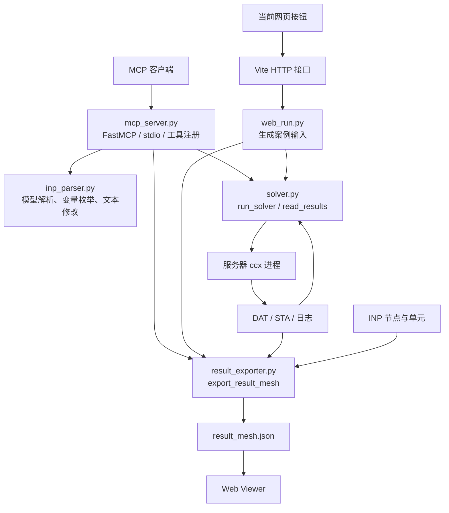

# CalculiX MCP 与结果导出工具实现说明（含代码行号）

本文按当前工作区源码说明“已有 CalculiX MCP 与结果导出工具”具体指什么。行号对应本次文档编写时的代码，后续代码修改可能导致行号移动；同时提供函数名方便检索。本次为源码核查，没有重新执行求解测试。

## 1. 实现边界与调用关系

现有实现由三部分组成：MCP 服务将 Python 函数暴露为工具；求解模块启动服务器上的 `ccx`；导出模块把输入网格和求解结果合并为 Viewer JSON。MCP 本身不执行有限元计算，计算由 CalculiX 可执行程序完成。



两条入口复用底层函数，但协议不同：MCP 客户端通过 FastMCP 调用；网页通过 HTTP 启动 Python 子进程，并用标准输入输出传 JSON。不能因为桥接脚本位于 `MCP/CalculiX` 目录，就认为网页已经走通 MCP 协议。

## 2. MCP 服务如何注册工具

[MCP/CalculiX/mcp_server.py:23](/Users/wuxizhi/code/CAE-Agent-Hub/MCP/CalculiX/mcp_server.py:23) 引入 `FastMCP`；[MCP/CalculiX/mcp_server.py:28](/Users/wuxizhi/code/CAE-Agent-Hub/MCP/CalculiX/mcp_server.py:28) 导入底层函数；[MCP/CalculiX/mcp_server.py:33](/Users/wuxizhi/code/CAE-Agent-Hub/MCP/CalculiX/mcp_server.py:33) 加载该目录下 `.env`；[MCP/CalculiX/mcp_server.py:63](/Users/wuxizhi/code/CAE-Agent-Hub/MCP/CalculiX/mcp_server.py:63) 创建服务实例。各函数通过 `@mcp.tool()` 注册，类型注解和说明文字用于描述工具输入与用途。[MCP/CalculiX/mcp_server.py:199](/Users/wuxizhi/code/CAE-Agent-Hub/MCP/CalculiX/mcp_server.py:199) 的 `main()` 调用 `mcp.run()`，项目按默认 stdio 方式启动。

实际对外工具名按注册函数名使用，部分工具带 `_tool` 后缀；不要直接照服务说明文字中的简写调用。

| 实际工具名 | MCP 入口 | 底层实现和职责 |
| --- | --- | --- |
| `fea_health` | [MCP/CalculiX/mcp_server.py:67](/Users/wuxizhi/code/CAE-Agent-Hub/MCP/CalculiX/mcp_server.py:67) | 检查 meshio 能否导入，调用 `detect_ccx()` 返回求解器位置 |
| `parse_inp` | [MCP/CalculiX/mcp_server.py:86](/Users/wuxizhi/code/CAE-Agent-Hub/MCP/CalculiX/mcp_server.py:86) | `parse_model()`：[MCP/CalculiX/tools/inp_parser.py:373](/Users/wuxizhi/code/CAE-Agent-Hub/MCP/CalculiX/tools/inp_parser.py:373)，返回节点数、单元类型、截面、材料、载荷等概览 |
| `list_design_vars_tool` | [MCP/CalculiX/mcp_server.py:97](/Users/wuxizhi/code/CAE-Agent-Hub/MCP/CalculiX/mcp_server.py:97) | `list_design_vars()`：[MCP/CalculiX/tools/inp_parser.py:416](/Users/wuxizhi/code/CAE-Agent-Hub/MCP/CalculiX/tools/inp_parser.py:416)，枚举壳厚、梁截面、材料和载荷变量 |
| `modify_card_tool` | [MCP/CalculiX/mcp_server.py:104](/Users/wuxizhi/code/CAE-Agent-Hub/MCP/CalculiX/mcp_server.py:104) | `modify_card()`：[MCP/CalculiX/tools/inp_parser.py:724](/Users/wuxizhi/code/CAE-Agent-Hub/MCP/CalculiX/tools/inp_parser.py:724)，按变量定位器修改输入文件 |
| `run_solver_tool` | [MCP/CalculiX/mcp_server.py:118](/Users/wuxizhi/code/CAE-Agent-Hub/MCP/CalculiX/mcp_server.py:118) | `run_solver()`：[MCP/CalculiX/tools/solver.py:63](/Users/wuxizhi/code/CAE-Agent-Hub/MCP/CalculiX/tools/solver.py:63)，启动 ccx 并返回运行状态及文件路径 |
| `read_results_tool` | [MCP/CalculiX/mcp_server.py:126](/Users/wuxizhi/code/CAE-Agent-Hub/MCP/CalculiX/mcp_server.py:126) | `read_results()`：[MCP/CalculiX/tools/solver.py:203](/Users/wuxizhi/code/CAE-Agent-Hub/MCP/CalculiX/tools/solver.py:203)，解析结果摘要 |
| `export_results_tool` | [MCP/CalculiX/mcp_server.py:133](/Users/wuxizhi/code/CAE-Agent-Hub/MCP/CalculiX/mcp_server.py:133) | `export_result_mesh()`：[MCP/CalculiX/tools/result_exporter.py:265](/Users/wuxizhi/code/CAE-Agent-Hub/MCP/CalculiX/tools/result_exporter.py:265)，写出 Viewer JSON |
| `optimize_structure_tool` | [MCP/CalculiX/mcp_server.py:161](/Users/wuxizhi/code/CAE-Agent-Hub/MCP/CalculiX/mcp_server.py:161) | `optimize_structure()`：[MCP/CalculiX/tools/optimizer.py:485](/Users/wuxizhi/code/CAE-Agent-Hub/MCP/CalculiX/tools/optimizer.py:485)，受求解次数限制的参数优化 |

健康检查的 `status` 当前固定为 `ok`，即使找不到 ccx，也只是返回说明字符串，见 [MCP/CalculiX/mcp_server.py:77](/Users/wuxizhi/code/CAE-Agent-Hub/MCP/CalculiX/mcp_server.py:77)。调用方必须检查 `meshio_available` 和 `ccx_exe`，不能仅判断 `status`。

客户端启动配置示例位于 [MCP/CalculiX/examples/mcp_config.example.json:1](/Users/wuxizhi/code/CAE-Agent-Hub/MCP/CalculiX/examples/mcp_config.example.json:1)：客户端启动指定 Python 和 `mcp_server.py`，并可通过环境变量设置 `CCX_EXE`。当前并未在此文件实现共享 HTTP MCP 服务、用户认证或任务队列。

## 3. 输入文件如何解析和修改

`parse_model()` 在 [MCP/CalculiX/tools/inp_parser.py:381](/Users/wuxizhi/code/CAE-Agent-Hub/MCP/CalculiX/tools/inp_parser.py:381) 读取 `.inp`，扫描关键字卡片，提取截面、材料和载荷；meshio 作为模型概览的辅助读取方式。它提供的是支持范围内的解析，不是通用 CAD 建模器或完整的 CalculiX 输入校验器。

`list_design_vars()` 为每个变量返回 `var_id`、当前值和 `modify` 定位信息。例如壳厚包含卡片类型、ELSET、数据行和字段位置，见 [MCP/CalculiX/tools/inp_parser.py:431](/Users/wuxizhi/code/CAE-Agent-Hub/MCP/CalculiX/tools/inp_parser.py:431)。

`modify_card()` 在 [MCP/CalculiX/tools/inp_parser.py:754](/Users/wuxizhi/code/CAE-Agent-Hub/MCP/CalculiX/tools/inp_parser.py:754) 把字符串变量 ID 解析回定位器，在 [MCP/CalculiX/tools/inp_parser.py:767](/Users/wuxizhi/code/CAE-Agent-Hub/MCP/CalculiX/tools/inp_parser.py:767) 定位并替换目标字段，然后写文件。它保留其他文本，避免通过 meshio 重写整个模型而丢失求解卡片。未传 `out_path` 时会覆盖输入文件，见 [MCP/CalculiX/tools/inp_parser.py:772](/Users/wuxizhi/code/CAE-Agent-Hub/MCP/CalculiX/tools/inp_parser.py:772)；自动化作业应使用独立目录或显式输出路径。

## 4. 如何执行真实 CalculiX 求解

### 4.1 查找求解器并启动进程

`detect_ccx()`：[MCP/CalculiX/tools/solver.py:48](/Users/wuxizhi/code/CAE-Agent-Hub/MCP/CalculiX/tools/solver.py:48)，依次使用 `CCX_EXE`、PATH 中的 `ccx`、`ccx_preCICE`。显式配置的 `CCX_EXE` 会直接返回，并没有在该函数内验证可执行性。

`_run_ccx()`：[MCP/CalculiX/tools/solver.py:87](/Users/wuxizhi/code/CAE-Agent-Hub/MCP/CalculiX/tools/solver.py:87)，解析输入路径，以输入文件所在目录作为工作目录，以文件名去掉 `.inp` 后作为作业名称。在 [MCP/CalculiX/tools/solver.py:112](/Users/wuxizhi/code/CAE-Agent-Hub/MCP/CalculiX/tools/solver.py:112) 组装：

```text
[ccx 可执行路径, "-i", 作业名]
```

[MCP/CalculiX/tools/solver.py:121](/Users/wuxizhi/code/CAE-Agent-Hub/MCP/CalculiX/tools/solver.py:121) 使用 `subprocess.run()`，采集输出、设置超时并等待结束。尽管某些源码说明使用了“fire-and-forget”，实际实现是同步等待，不是提交后立即返回作业 ID 的异步队列。超时处理位于 [MCP/CalculiX/tools/solver.py:132](/Users/wuxizhi/code/CAE-Agent-Hub/MCP/CalculiX/tools/solver.py:132)。

### 4.2 如何判断成功

[MCP/CalculiX/tools/solver.py:145](/Users/wuxizhi/code/CAE-Agent-Hub/MCP/CalculiX/tools/solver.py:145) 扫描合并的 stdout/stderr 中的 `*ERROR`；[MCP/CalculiX/tools/solver.py:147](/Users/wuxizhi/code/CAE-Agent-Hub/MCP/CalculiX/tools/solver.py:147) 检查 `.sta` 和 `.dat`；[MCP/CalculiX/tools/solver.py:154](/Users/wuxizhi/code/CAE-Agent-Hub/MCP/CalculiX/tools/solver.py:154) 的实际判定为：

```text
没有 *ERROR
且没有超时
且（STA 存在数字数据行 或 DAT 非空）
```

[MCP/CalculiX/tools/solver.py:157](/Users/wuxizhi/code/CAE-Agent-Hub/MCP/CalculiX/tools/solver.py:157) 返回状态、返回码、错误、结果路径、日志末尾 2000 字符和耗时。返回码被记录，但没有作为当前成功条件。

这属于初步运行检查，不等于工程正确性验证：非空 DAT 不保证所需字段齐全，已有目录中的旧文件也可能干扰判定。MCP 直接调用者需隔离作业目录；仍需增加结果完整性、文件归属和工程验收检查。

## 5. 如何读取结果摘要

| 处理 | 代码位置 | 具体实现 |
| --- | --- | --- |
| 定位 DAT | [MCP/CalculiX/tools/solver.py:226](/Users/wuxizhi/code/CAE-Agent-Hub/MCP/CalculiX/tools/solver.py:226) | 接受文件或目录；目录有多个 DAT 时警告并取排序后的第一个 |
| 读取与汇总 | [MCP/CalculiX/tools/solver.py:239](/Users/wuxizhi/code/CAE-Agent-Hub/MCP/CalculiX/tools/solver.py:239) | 检查文件存在且非空，调用应力、位移、频率解析器 |
| 最大 von Mises 应力 | [MCP/CalculiX/tools/solver.py:282](/Users/wuxizhi/code/CAE-Agent-Hub/MCP/CalculiX/tools/solver.py:282) | 从六个应力分量计算等效应力，取所有解析点中的最大值 |
| 最大位移模长 | [MCP/CalculiX/tools/solver.py:334](/Users/wuxizhi/code/CAE-Agent-Hub/MCP/CalculiX/tools/solver.py:334) | 对节点位移计算 `sqrt(ux² + uy² + uz²)` 并取最大值 |
| 固有频率 | [MCP/CalculiX/tools/solver.py:375](/Users/wuxizhi/code/CAE-Agent-Hub/MCP/CalculiX/tools/solver.py:375) | 读取特征值表中的阶次、特征值、角频率、周频率 |
| 体积与质量 | [MCP/CalculiX/tools/solver.py:429](/Users/wuxizhi/code/CAE-Agent-Hub/MCP/CalculiX/tools/solver.py:429) | 由同名 INP 的几何、截面和密度估算；并非读取 DAT 中的质量字段 |

von Mises 计算位于 [MCP/CalculiX/tools/solver.py:316](/Users/wuxizhi/code/CAE-Agent-Hub/MCP/CalculiX/tools/solver.py:316)：

```text
σvm = sqrt(((σxx−σyy)² + (σyy−σzz)² + (σzz−σxx)²) / 2
           + 3 × (τxy² + τxz² + τyz²))
```

[MCP/CalculiX/tools/solver.py:258](/Users/wuxizhi/code/CAE-Agent-Hub/MCP/CalculiX/tools/solver.py:258) 对未解析到的应力或位移记录 warnings；[MCP/CalculiX/tools/solver.py:266](/Users/wuxizhi/code/CAE-Agent-Hub/MCP/CalculiX/tools/solver.py:266) 仍可返回 `status: ok`，相应指标为 `None`。调用方必须检查数据计数和警告。单位继承输入模型的工作单位制，此层没有自动进行单位转换。

## 6. 如何导出轻量结果

### 6.1 数据来源与编号合并

核心函数为 [MCP/CalculiX/tools/result_exporter.py:265](/Users/wuxizhi/code/CAE-Agent-Hub/MCP/CalculiX/tools/result_exporter.py:265) 的 `export_result_mesh()`。当前实现采用 **INP 拓扑 + DAT 场数据**，没有读取 FRD 来生成 Viewer 网格。

| 步骤 | 代码位置 | 输出 |
| --- | --- | --- |
| 扫描 INP 的 NODE / ELEMENT | [MCP/CalculiX/tools/result_exporter.py:74](/Users/wuxizhi/code/CAE-Agent-Hub/MCP/CalculiX/tools/result_exporter.py:74) | 原始节点编号、坐标、单元类型和连接编号 |
| 解析 DAT 位移 | [MCP/CalculiX/tools/result_exporter.py:117](/Users/wuxizhi/code/CAE-Agent-Hub/MCP/CalculiX/tools/result_exporter.py:117) | `节点编号 → [ux, uy, uz]` |
| 解析 DAT 应力 | [MCP/CalculiX/tools/result_exporter.py:145](/Users/wuxizhi/code/CAE-Agent-Hub/MCP/CalculiX/tools/result_exporter.py:145) | `单元编号 → 最大积分点 von Mises` |
| 合并数据 | [MCP/CalculiX/tools/result_exporter.py:297](/Users/wuxizhi/code/CAE-Agent-Hub/MCP/CalculiX/tools/result_exporter.py:297) | 按原始编号关联网格与场数据 |
| 构造节点 | [MCP/CalculiX/tools/result_exporter.py:336](/Users/wuxizhi/code/CAE-Agent-Hub/MCP/CalculiX/tools/result_exporter.py:336) | 坐标、位移和用于展示的变形后坐标 |
| 构造单元 | [MCP/CalculiX/tools/result_exporter.py:361](/Users/wuxizhi/code/CAE-Agent-Hub/MCP/CalculiX/tools/result_exporter.py:361) | 单元编号、类型、连接关系和颜色标量 |
| 组装 JSON | [MCP/CalculiX/tools/result_exporter.py:386](/Users/wuxizhi/code/CAE-Agent-Hub/MCP/CalculiX/tools/result_exporter.py:386) | 元数据、节点、单元和场量范围 |
| 写出文件 | [MCP/CalculiX/tools/result_exporter.py:416](/Users/wuxizhi/code/CAE-Agent-Hub/MCP/CalculiX/tools/result_exporter.py:416) | 默认写 `<输入文件名>.result_mesh.json`，也可显式指定路径 |

`connectivity` 保存节点标签，不是数组下标。静力单元的 `mises` 采用积分点最大值，不是节点外推平均值；与其他软件云图比较时要统一统计方式。

### 6.2 变形放大与数据结构

[MCP/CalculiX/tools/result_exporter.py:244](/Users/wuxizhi/code/CAE-Agent-Hub/MCP/CalculiX/tools/result_exporter.py:244) 自动选取显示比例，目标是让最大显示位移约为模型最大尺寸的 15%，比例限制为 1 至 1000000。用户也可显式指定比例。

[MCP/CalculiX/tools/result_exporter.py:345](/Users/wuxizhi/code/CAE-Agent-Hub/MCP/CalculiX/tools/result_exporter.py:345) 直接写入：

```text
deformed = coordinates + displacement × deformationScale
```

Viewer 使用 `deformed` 坐标，不能再重复放大。相关读取见 [viewer/components/CaeResultViewer.js:196](/Users/wuxizhi/code/CAE-Agent-Hub/viewer/components/CaeResultViewer.js:196)、[viewer/components/CaeResultViewer.js:253](/Users/wuxizhi/code/CAE-Agent-Hub/viewer/components/CaeResultViewer.js:253)。

导出的字段结构如下（为结构说明，省略具体节点和单元）：

```text
schemaVersion, source, instance, step, frame
 deformationScale, elementType
 nodes[]: label, coordinates, displacement, deformed
 elements[]: label, type, connectivity, mises
 fieldRanges: misesMin, misesMax, maxDisplacement
```

这里的“轻量化”主要是转换为浏览器可读的数据，没有实现网格简化、压缩或分块。JSON 也尚未包含完整的单位声明、run_id 和结果验证证据。

### 6.3 模态结果

[MCP/CalculiX/tools/result_exporter.py:185](/Users/wuxizhi/code/CAE-Agent-Hub/MCP/CalculiX/tools/result_exporter.py:185) 按阶次标记读取振型；[MCP/CalculiX/tools/result_exporter.py:310](/Users/wuxizhi/code/CAE-Agent-Hub/MCP/CalculiX/tools/result_exporter.py:310) 选取指定 `mode`；[MCP/CalculiX/tools/result_exporter.py:326](/Users/wuxizhi/code/CAE-Agent-Hub/MCP/CalculiX/tools/result_exporter.py:326) 将位移归一化到最大模长为 1。[MCP/CalculiX/tools/result_exporter.py:351](/Users/wuxizhi/code/CAE-Agent-Hub/MCP/CalculiX/tools/result_exporter.py:351) 计算各单元节点归一化模长的均值，用作颜色标量；兼容字段 `mises` 在此表示振型幅值，不是应力。

[MCP/CalculiX/tools/result_exporter.py:402](/Users/wuxizhi/code/CAE-Agent-Hub/MCP/CalculiX/tools/result_exporter.py:402) 增加 `analysisType: modal`、`mode`、`frequencyHz`、`fieldLabel` 和 `rawMaxDisplacement`。原始振型幅值也不代表特定外载荷下的实际振动位移。本函数一次导出一个模态，不自动生成多模态动画帧数组。

### 6.4 缺失数据和多步结果的限制

[MCP/CalculiX/tools/result_exporter.py:300](/Users/wuxizhi/code/CAE-Agent-Hub/MCP/CalculiX/tools/result_exporter.py:300) 在无 DAT 时允许导出纯网格；[MCP/CalculiX/tools/result_exporter.py:340](/Users/wuxizhi/code/CAE-Agent-Hub/MCP/CalculiX/tools/result_exporter.py:340) 对缺失位移填零；[MCP/CalculiX/tools/result_exporter.py:364](/Users/wuxizhi/code/CAE-Agent-Hub/MCP/CalculiX/tools/result_exporter.py:364) 对缺失应力填零。模态请求缺少 DAT 或阶次则报错。纯网格零场不能被解读为“求解得到零应力”。

静力位移解析会覆盖同一节点此前读到的值，而单元应力解析保留遇到的最大值，因此多个增量或步骤并不会形成一致的逐帧数据集。当前导出器不是通用瞬态动画导出器，也不是原理讲解动画生成器。

## 7. 当前网页如何复用这些工具

| 环节 | 代码位置 | 行为 |
| --- | --- | --- |
| 用户提交 | [viewer/components/CaeAgentWorkspace.jsx:94](/Users/wuxizhi/code/CAE-Agent-Hub/viewer/components/CaeAgentWorkspace.jsx:94) | `runCase()` POST 案例 ID、分析类型和参数 |
| HTTP 接口 | [viewer/vite.config.mjs:337](/Users/wuxizhi/code/CAE-Agent-Hub/viewer/vite.config.mjs:337) | `/__cae/calculix/run` 读取请求并调用桥接函数 |
| Python 子进程 | [viewer/vite.config.mjs:266](/Users/wuxizhi/code/CAE-Agent-Hub/viewer/vite.config.mjs:266) | `runCalculixBridge()` 启动 `web_run.py`，stdin 传 JSON，读取 stdout JSON |
| 参数校验 | [MCP/CalculiX/web_run.py:46](/Users/wuxizhi/code/CAE-Agent-Hub/MCP/CalculiX/web_run.py:46) | 读取尺寸、载荷、材料并检查数值 |
| 选择模板 | [MCP/CalculiX/web_run.py:60](/Users/wuxizhi/code/CAE-Agent-Hub/MCP/CalculiX/web_run.py:60) | 静力或模态悬臂梁生成器 |
| 环境补充 | [MCP/CalculiX/web_run.py:25](/Users/wuxizhi/code/CAE-Agent-Hub/MCP/CalculiX/web_run.py:25) | 尝试 Python 同目录的 ccx，并配置动态库路径 |
| 独立作业目录 | [MCP/CalculiX/web_run.py:82](/Users/wuxizhi/code/CAE-Agent-Hub/MCP/CalculiX/web_run.py:82) | 在 `.cae-web-runs` 下创建临时作业目录 |
| 求解与导出 | [MCP/CalculiX/web_run.py:88](/Users/wuxizhi/code/CAE-Agent-Hub/MCP/CalculiX/web_run.py:88) | 顺序调用 `run_solver`、`read_results`、`export_result_mesh` |
| 返回网页 | [MCP/CalculiX/web_run.py:99](/Users/wuxizhi/code/CAE-Agent-Hub/MCP/CalculiX/web_run.py:99) | 返回 run_id、summary 和完整 result_mesh；不是 MCP 工具响应 |
| Viewer 接收 | [viewer/components/CaeResultViewer.js:510](/Users/wuxizhi/code/CAE-Agent-Hub/viewer/components/CaeResultViewer.js:510) | 将传入的 resultMesh 设置为展示数据 |

模板通过 [MCP/CalculiX/examples/gen_cantilever.py:91](/Users/wuxizhi/code/CAE-Agent-Hub/MCP/CalculiX/examples/gen_cantilever.py:91) 的 `*NODE PRINT ... U` 与 `*EL PRINT ... S` 请求 DAT 位移和应力数据，这是后续解析能取得字段的前提。

两处需注意的现状：

- [viewer/vite.config.mjs:347](/Users/wuxizhi/code/CAE-Agent-Hub/viewer/vite.config.mjs:347) 仅向桥接脚本传 `payload.parameters || payload`。前端把 `case_id`、`analysis` 放在外层时会丢失它们，桥接脚本可能回落为静力案例；不能只凭模态 RUN 标识认定网页链路正确。
- [MCP/CalculiX/web_run.py:103](/Users/wuxizhi/code/CAE-Agent-Hub/MCP/CalculiX/web_run.py:103) 返回的 `verified` 为桥接脚本设定的状态；脚本没有独立检查摘要 warnings、字段覆盖率和工程验收条件。这不代表已完成完整的物理验证。

## 8. 已有测试与后续工作

仓库已有测试入口：

| 测试 | 代码位置 |
| --- | --- |
| 求解执行、结果合理性 | [MCP/CalculiX/tests/test_solver.py:32](/Users/wuxizhi/code/CAE-Agent-Hub/MCP/CalculiX/tests/test_solver.py:32) |
| 无结果文件时的纯网格 schema | [MCP/CalculiX/tests/test_exporter.py:28](/Users/wuxizhi/code/CAE-Agent-Hub/MCP/CalculiX/tests/test_exporter.py:28) |
| 真实 DAT 字段导出 | [MCP/CalculiX/tests/test_exporter.py:56](/Users/wuxizhi/code/CAE-Agent-Hub/MCP/CalculiX/tests/test_exporter.py:56) |
| 模态频率表、振型拆分与 schema | [MCP/CalculiX/tests/test_modal.py:61](/Users/wuxizhi/code/CAE-Agent-Hub/MCP/CalculiX/tests/test_modal.py:61) |
| 模态端到端求解 | [MCP/CalculiX/tests/test_modal.py:114](/Users/wuxizhi/code/CAE-Agent-Hub/MCP/CalculiX/tests/test_modal.py:114) |

这些是已有测试代码的位置，本次没有重跑，不据此宣称当前环境全部通过。

接入企业国产 CAE 时，可复用“工具注册 → 输入准备 → 执行 → 摘要读取 → 网格与场数据导出”的分层，但需重写厂商执行和结果读取适配器。建设完整 Agent 还需补齐 MCP 客户端编排、异步作业状态、多用户隔离、结果验证，以及每案例原理动画生成。
